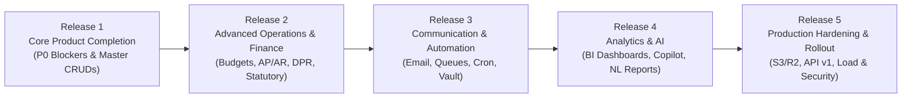

# NSD CRM 2.0 — Master Development Roadmap & Prioritized Backlog

**Phase:** 5A — Master Product Gap Analysis (Read-Only Audit)  
**Date:** 2026-11-15  
**Repository:** `/Users/andrew/Developer/NSD-CRM-2.0`

---

## 1. Release Strategy Overview

Development is structured into **five disciplined, independently testable releases**. Each release preserves 100% of the working 182-test foundation, respects the approved simplified UX principles (one primary action per page, plain business language, progressive disclosure, strict role/site boundaries), and passes a mandatory multi-layer verification gate before advancing.

---

## 2. Detailed Release Plan & Measurable Acceptance Criteria

### Release 1: Core Product Completion (Closing Operational & Onboarding Blockers)

**Objective:** Make every existing module self-sufficient for a brand-new company without database seeding, fix all audit/permission/status defects uncovered in Phase 5A, complete inventory stock movements, and unify approvals.

#### Scope & Deliverables
1. **Security, Tenancy & Defect Fixes (Immediate):**
   - Fix `DashboardController.php` `AuditLog` query missing `->where('company_id', $companyId)` and introduce `AuditLog::forCompany()` + automatic sensitive-field redaction.
   - Fix `DashboardController.php` pending Goods Receipt PO query (`status = 'issued'` instead of `'ordered'`).
   - Align `PayrollController` permission checks with `PermissionCatalog` (`payroll.create`, `payroll.edit`, `payroll.approve`) and align `office_staff` `procurement.request` default permission.
   - Wire `$recentLogs` on `ProjectController::show()` (`activity` tab) and paginate `/reports/audit-logs`.
2. **Company Profile, Branding & Multi-Company Switcher:**
   - Company Settings screen (`/admin/company`) to edit registered address, GSTIN, PAN, bank account/IFSC, invoice prefix/starting sequence, default work order terms, logo, and authorized signature upload.
   - Dynamic company name/logo in `layouts/app.blade.php` + interactive Company Switcher dropdown when user belongs to `> 1` active companies.
3. **Missing Master Directories (Zero-Seed Self-Sufficiency):**
   - **Warehouses, Material Categories & Materials CRUD** (`/inventory/warehouses`, `/inventory/materials`).
   - **Vendors Master Directory CRUD** (`/procurement/vendors`) + `vendor_id` FK on `purchase_orders`.
   - **Subcontractors CRUD** (`/workforce/subcontractors` create/edit/toggle) + **Clients Directory CRUD** (`/clients`).
   - **Leave Types, Shifts & Holidays full CRUD** + annual leave quota balance enforcement & holiday exclusion.
4. **Complete Inventory Ledger Operations & Procurement Actions:**
   - Purchase Request `reject` & `cancel` actions; dynamic `{COMPANY_CODE}` document prefixes; Printable **Purchase Order PDF** & **GRN PDF**.
   - **Warehouse Issue to Site/Work Order (`warehouse_issue`)**, **Inter-Warehouse/Site Stock Transfer (`inter_site_transfer`)**, **Site Material Return (`site_return`)**, and **Manager-Approved Stock Adjustments (`stock_adjustment`)** with deadlock-free `lockForUpdate()`.
5. **Workforce, Measurements, RA Bills & Unified Approvals:**
   - Link `workers.user_id -> users.id` for employee accounts + Printable **Worker QR ID Badge PDF**.
   - Independent Measurement verification (`draft` -> `verified` via `measurements.approve`) + Printable **Measurement Book PDF**.
   - Global **RA Bills Register (`/ra-bills`)** + **IGST** support alongside CGST/SGST.
   - **Unified Pending Approvals Inbox (`/approvals`)** + real-time **In-App Approval Notifications** across all workflows.
   - **Private `VaultStorage` Disk Abstraction** (`config('filesystems.disks.vault')` + `storage_disk` columns) replacing hardcoded `'local'` calls.
   - Paginate Monthly Attendance Register & Task list for large workforces.

#### Release 1 Acceptance Criteria
- [ ] A freshly provisioned company (`nsd:create-admin`) can configure its GST/Bank profile, create Warehouses, Material Categories, Materials, Vendors, Subcontractors, Clients, Projects, Sites, Workers, and Shifts 100% through the web UI with zero SQL/seeder intervention.
- [ ] All 4 inventory movement types (`goods_receipt`, `warehouse_issue`, `inter_site_transfer`, `site_return`) + `stock_adjustment` pass parallel `proc_open` concurrency tests with zero negative stock or lost updates.
- [ ] Cross-tenant isolation tests verify zero leakage on `DashboardController` audit logs, Global RA Bills, Vendors, Warehouses, and Unified Approvals.
- [ ] Custom roles (`accountant`, `hr_manager`, `procurement_officer`) pass end-to-end Payroll and Procurement authorization tests.
- [ ] All existing 182 tests + ~45 new Release 1 tests pass (`0` failures), and `VaultStorage` works identically with `Storage::fake('vault')`.

---

### Release 2: Advanced Operations & Complete Finance Suite

**Objective:** Deliver full construction project financial control—from Project Budgets, Daily Site Diaries (DPR), and Subcontractor Work Orders to Tax Invoices, Vendor/Subcontractor Bills (AP), Site Expenses, Payment Tracking (AR/AP), Statutory Payroll, and Budget-vs-Actuals P&L.

#### Scope & Deliverables
1. **Project Budgets & Cost Control Foundation:**
   - `project_budgets` & cost-head allocations (`labour`, `materials`, `subcontractors`, `equipment`, `overheads`), budget revisions, and site-level cost tagging (`project_id` on PRs, POs, Issues, Expenses).
2. **Advanced Field Operations & Workforce:**
   - **Structured Daily Site Diary / DPR** (weather, auto-pulled trade headcount, machinery/equipment log, hindrances, photos, Site Manager sign-off lock, printable DPR PDF).
   - **Outward Subcontractor Work Orders** linked to `subcontractor_id` and parent project BOQ.
   - **Worker Shift Rostering** (assigning shifts to crews/workers, overnight shift support) & **Expanded Employee/Worker Self-Service** (view/download Payslips PDF, Monthly Attendance calendar, Leave balances, Advance ledger; "My Workspace" for linked CRM `users`).
   - **Statutory Payroll Engine** (configurable EPF, ESIC, PT, TDS rules + Bank NEFT/UPI payout sheet XLSX/CSV export) & **Moving Weighted Average Cost (WAC)** inventory valuation.
3. **Complete Construction Finance Module (`/finance`):**
   - **Standalone & RA-Linked Tax Invoices (`/finance/invoices`):** Place-of-supply CGST+SGST vs IGST, Credit/Debit Notes, GSTR-1 CSV export.
   - **Vendor & Subcontractor Bills (`/finance/vendor-bills`):** 3-way match (PO + GRN + Supplier Bill), GST Input Tax Credit, Section 194C TDS, retention held, 2-tier approval, private invoice vault upload.
   - **Site Expenses & Petty Cash (`/finance/expenses`):** Site imprest wallets, fuel/transport/site expense vouchers, receipt uploads, manager approval.
   - **Payment Tracking Ledger (`/finance/payments`):** Client collections (bank received + client TDS + retention withheld/released) and Vendor/Subcontractor/Expense/Payroll disbursements (partial & full payments, UTR tracking).
   - **Budget vs Actuals & Financial Reports:** Live Project P&L (Revenue vs Committed vs Actual Cost), AR Aging, AP Aging, Retention Register, and Monthly Cashflow report (CSV/XLSX/PDF).

#### Release 2 Acceptance Criteria
- [ ] Recording a PO -> GRN -> Warehouse Issue + Vendor Bill + Locked Payroll + Site Expense + Approved RA Bill / Tax Invoice reconciles to the exact rupee in **Project Budget vs Actuals** and **Project P&L**.
- [ ] 3-way match prevents approving a Vendor Bill whose billed quantity exceeds confirmed GRN quantity without explicit authorized variance override.
- [ ] Partial client receipts, TDS deductions, and retention releases accurately compute net receivable aging per Client and Work Order.
- [ ] Assigned Tax Invoice numbers are strictly immutable; adjustments generate linked Credit/Debit Notes with audit trails.
- [ ] Non-finance site roles (`supervisor`, `site_engineer`) remain blocked (`403`) from viewing restricted margin/AP/AR financial ledgers.

---

### Release 3: Communication, Document Vault & Workflow Automation

**Objective:** Transform NSD CRM 2.0 from a passive system-of-record into a proactive operational platform with background queues, transactional emails, scheduled reminders, a unified Document Center, and configurable workflow rules.

#### Scope & Deliverables
1. **Multi-Tenant Queue & Scheduler Infrastructure:**
   - `TenantAwareJob` base pipeline (`after_commit = true`, automatic `TenantContext` binding & cleanup), failed-job monitoring UI for Super/Company Admins, and scheduled cron runner (`routes/console.php`).
2. **Transactional Email & Notification Center:**
   - Dedicated `NotificationController` (`/notifications`), topbar quick-preview dropdown, per-user channel preferences (In-App vs Email).
   - Queued branded emails (`ShouldQueue`) for: User Account Invites, Self-Service Password Reset, 2FA Alerts, Pending Approval Requests, Approved PO/Invoice dispatch, and Weekly Executive Summary.
3. **Automated Reminders & Repetitive Task Automation:**
   - Idempotent scheduled jobs (`notification_dispatches` deduplication table) for: Overdue Tasks & Milestones, Aging Approvals (> 24h/48h), Expiring Worker Documents (30d/7d), Work Order Retention Release & DLP end dates, Overdue Invoices/Vendor Bills, and Missing Daily Muster alerts.
   - Recurring Site Tasks engine, Low-Stock auto-draft Purchase Requests, and Project/Milestone template cloning.
   - Configurable **Company Approval Threshold Rules** (value-based tier routing + out-of-office approver delegation).
4. **Unified Document Center & Version Lineage (`/documents`):**
   - Cross-module Document Vault with authorized search/filtering across Drawings, Contracts, POs, Worker KYC, Vendor Bills, and Invoices; inline PDF/image preview; `document_group_id` version threads with `superseded` badges and download audit logging.
   - Formatted, permission-filtered **Activity Timeline** across Projects, Sites, and Work Orders with `@mention` comment alerts.

#### Release 3 Acceptance Criteria
- [ ] Queued jobs enforce strict `company_id` isolation across consecutive multi-tenant jobs in a long-running `queue:work` process (verified by multi-tenant queue isolation tests).
- [ ] Scheduled reminder commands are 100% idempotent (running `schedule:run` twice on the same day sends zero duplicate notifications/emails).
- [ ] Document Center search never returns metadata or files from unassigned sites, restricted `visibility_roles`, or other companies.
- [ ] Self-service Forgot Password flow passes token-expiry, rate-limit, and session-invalidation security tests.

---

### Release 4: Executive Analytics, BI & Authorized AI Assistant

**Objective:** Empower company leadership and managers with deep operational/financial intelligence, natural-language reporting, and an authorization-sandboxed AI Operations Copilot.

#### Scope & Deliverables
1. **Management Analytics & BI Suite (`/analytics`):**
   - Executive Portfolio Dashboard (Revenue vs Collections, WIP/Unbilled Measured Work, Project Margin Ranking, Cashflow Forecast) — cleanly separated from the simplified Company Admin setup dashboard.
   - **Project Performance Analytics:** BOQ physical completion vs timeline vs cost burn (Earned Value indicators).
   - **Workforce Productivity Analytics:** Trade deployment mix, Subcontractor vs Direct Labour cost/output efficiency, overtime & absenteeism heatmaps.
   - **Inventory & Procurement Analytics:** Material burn per site/BOQ item, supplier unit-price history & variance, dead-stock aging.
   - Asynchronous queued heavy report exports (`ReportExport` vault) with CSV, live-formula XLSX, and executive PDF layouts.
2. **Authorized AI Copilot & Multimodal Document Extraction (`/ai`):**
   - **Sandboxed Tool-Calling Architecture (`AuthorizedAiService`):** Read-only PHP tools strictly bound to `TenantContext::getCompanyId()`, `User::hasPermission()`, and `User::accessibleSiteIds()`, with automatic PII stripping and per-company token budgets/opt-in toggle.
   - **Natural-Language Business Reporting:** Plain-language questions (English, Hindi, Marathi) mapped to deterministic `ReportQuerySpec` builders (never raw LLM-generated SQL) producing verifiable tables, charts, and exports.
   - **AI-Assisted Non-JSW PO & Vendor Invoice OCR:** Multimodal extraction for arbitrary client PO PDFs and scanned supplier invoices, populating the existing human-in-the-loop review & arithmetic validation screen before any record is saved.

#### Release 4 Acceptance Criteria
- [ ] Adversarial prompt-injection security tests confirm the AI Assistant cannot access another company's data, unassigned sites, unauthorized modules (e.g., Supervisor asking for Payroll/Margins), or raw SQL execution.
- [ ] Every AI prompt, tool invocation, and token count is logged in `AuditLog` and respects per-company enablement toggles.
- [ ] All Analytics KPIs match underlying ledger totals to 100% precision and load in `< 400ms` (with optional short-TTL tenant-scoped caching).

---

### Release 5: Production Hardening, Mobile API v1 & Live Rollout

**Objective:** Complete cloud infrastructure readiness (S3/R2 Vault, Redis/DB Queue Workers, Production Docker Entrypoint), expose `/api/v1` for Android/iOS field apps, execute full load/security benchmarking, and perform controlled staging-to-production rollout.

#### Scope & Deliverables
1. **Mobile & Integration API (`/api/v1` + Laravel Sanctum):**
   - Token authentication for Staff & Workers, device management/revocation, rate limiting, and `ApiSetTenantContext` middleware.
   - Offline-resilient field endpoints (`X-Idempotency-Key` / `client_uuid`) for Attendance Punches (with optional punch selfie upload), Muster Rolls, Site Measurements, Tasks, Site Diary entries, and Bootstrap Reference Sync.
   - Accounting export connectors (Tally Prime XML/CSV voucher export for Invoices, Vendor Bills, Payments, Payroll).
2. **Cloud Production Infrastructure & Storage Cutover:**
   - Activate S3-compatible private object storage (AWS S3 / Cloudflare R2) for the `'vault'` disk + migration CLI command (`nsd:vault-sync`) to verify/migrate any local files safely.
   - Dedicated `docker/production-entrypoint.sh` (decoupled from demo-only `nsd_crm_demo` check while retaining strict guards, zero auto-seeding in prod), multi-service orchestration (Web + Queue Worker + Cron Scheduler), automated encrypted DB backups, and `/healthz` readiness checks.
3. **Scale, Security & Accessibility Certification:**
   - Load & concurrency benchmarking at `10,000` workers, `300,000` monthly attendance rows, and `50` concurrent users (`p95 < 500ms`).
   - Full OWASP Top-10 security audit (CSP/HSTS headers, dependency CVE scan, 2FA enforcement option for admins/managers, rate-limit audit, backup restore drill) and WCAG AA desktop/mobile UX pass.

#### Release 5 Acceptance Criteria
- [ ] Redeploying or restarting the production container preserves 100% of uploaded/exported documents in private S3/R2 storage.
- [ ] `/api/v1` endpoints pass full Sanctum token scoping, site-restriction, and duplicate `client_uuid` offline-replay idempotency tests.
- [ ] Benchmark suite verifies `< 50` SQL queries and `< 500ms` p95 response time across Dashboard, Attendance Register, Workforce, Work Orders, and Finance registers under synthetic enterprise load.
- [ ] Staging smoke tests, DB backup/restore verification, and zero-downtime migration rehearsal pass prior to production approval.

---

## 3. Master Prioritized Implementation Backlog

| Backlog ID | Priority | Release | Domain | Feature / Task | Complexity | Key Dependencies |
| :--- | :---: | :---: | :--- | :--- | :---: | :--- |
| **BL-01** | **P0** | R1 | Admin / Security | Fix `DashboardController` `AuditLog` missing `company_id` filter + add `AuditLog::forCompany()` & sensitive-field redaction | S | None |
| **BL-02** | **P0** | R1 | Procurement / UI | Fix `DashboardController` PO status filter (`'issued'`) + align `PayrollController` & `office_staff` permission keys with `PermissionCatalog` | S | None |
| **BL-03** | **P0** | R1 | Documents / Arch | Implement `VaultStorage` configurable private disk (`vault`) + `storage_disk` columns replacing hardcoded `'local'` calls | M | None |
| **BL-04** | **P0** | R1 | Admin | Company Profile & Settings UI (`/admin/company`: GSTIN, PAN, Bank, Invoice Prefix, Signature/Logo, Terms) + Topbar Company Switcher | M | BL-03 |
| **BL-05** | **P0** | R1 | Inventory | Warehouses, Material Categories & Materials Catalog CRUD (`/inventory/warehouses`, `/inventory/materials`) | M | None |
| **BL-06** | **P0** | R1 | Procurement | Vendors Master Directory CRUD (`/procurement/vendors`) + link `vendor_id` to `PurchaseOrder` + dynamic `{COMPANY_CODE}` doc prefixes | M | None |
| **BL-07** | **P0** | R1 | Workforce / Ops | Subcontractors CRUD (`/workforce/subcontractors`) + Clients Directory CRUD (`/clients`) | S | None |
| **BL-08** | **P0** | R1 | Inventory | Stock Issue (`warehouse_issue`), Inter-Site Transfer (`inter_site_transfer`), Site Return (`site_return`) & Stock Adjustment workflows | M | BL-05 |
| **BL-09** | **P0** | R1 | Procurement | Purchase Request Reject/Cancel actions + Printable Purchase Order PDF & GRN PDF exports | M | BL-06 |
| **BL-10** | **P0** | R1 | Operations / Comm | Unified Pending Approvals Center (`/approvals`) + In-App Approval Notifications across WOs, RA Bills, PRs, Leaves, Corrections | M | None |
| **BL-11** | **P0** | R1 | Finance | Global RA Bills Register (`/ra-bills`) + Inter-State IGST support on Work Orders & RA Bills | M | BL-04 |
| **BL-12** | **P1** | R1 | Workforce | Link `workers.user_id <-> users.id` (atomic deactivation) + Printable Worker QR ID Card PDF + Payroll Payslip PDF & Bank NEFT CSV | M | BL-02 |
| **BL-13** | **P1** | R1 | Workforce | Leave Types, Shifts & Holidays full CRUD + Leave Annual Quota Balance ledger & Holiday exclusion | M | None |
| **BL-14** | **P1** | R1 | Operations | Measurement `draft -> verified` independent verification + Printable Measurement Book PDF + Milestone edit/delete + Project Activity logs | M | BL-01 |
| **BL-15** | **P1** | R1 | Scalability | Paginate Monthly Attendance Register, Task Board/List, and Audit Logs + add composite DB indexes | M | None |
| **BL-16** | **P1** | R2 | Operations | Project & Site Budgets (`project_budgets` by cost head, revisions, `project_id` cost tagging across PR/PO/Issues) | M | R1 |
| **BL-17** | **P1** | R2 | Finance | Standalone & RA-Linked Tax Invoices Module (`/finance/invoices`), Credit/Debit Notes & GSTR-1 export | L | BL-04, BL-11 |
| **BL-18** | **P1** | R2 | Finance | Vendor & Subcontractor Bills (`/finance/vendor-bills`) with PO/GRN 3-Way Match, GST ITC, and TDS u/s 194C | L | BL-06, BL-07 |
| **BL-19** | **P1** | R2 | Finance | Site Expenses & Petty Cash Wallets (`/finance/expenses`) with receipt vault uploads & approval | M | BL-03, BL-16 |
| **BL-20** | **P1** | R2 | Finance | Payment Tracking Ledger (`/finance/payments`: Client AR receipts, TDS/Retention tracking, Vendor/Payroll AP payouts) | L | BL-17, BL-18, BL-19 |
| **BL-21** | **P1** | R2 | Finance | Budget vs Actuals Costing Engine & Financial Reports (Project P&L, AR/AP Aging, Retention, Cashflow) | L | BL-16..BL-20 |
| **BL-22** | **P1** | R2 | Operations | Structured Daily Site Diary / DPR (weather, auto-headcount, machinery/fuel log, sign-off lock, DPR PDF) + Outward Subcontractor WOs | M | BL-07 |
| **BL-23** | **P1** | R2 | Workforce / Inv | Statutory Payroll Deductions (EPF, ESIC, PT, TDS) + Worker Shift Rosters + Portal Payslip/Attendance Self-Service + WAC Inventory Valuation | L | BL-08, BL-12 |
| **BL-24** | **P1** | R3 | Arch / Comm | `TenantAwareJob` Queue Pipeline (`after_commit`) + Dedicated `NotificationController` + Queued Transactional Emails & Password Reset | M | R1 |
| **BL-25** | **P1** | R3 | Automation | Laravel Scheduler Automated Reminders (overdue tasks/milestones, aging approvals, expiring KYC docs, DLP/retention due, missing muster) | M | BL-24 |
| **BL-26** | **P2** | R3 | Documents | Unified Document Center (`/documents`) with RBAC cross-module search, inline preview, and `document_group_id` version lineage | M | BL-03 |
| **BL-27** | **P2** | R3 | Automation | Configurable Company Approval Threshold Rules, Recurring Site Tasks, and Low-Stock Auto-Draft PRs | M | BL-10, BL-25 |
| **BL-28** | **P1** | R4 | Analytics | Executive Portfolio, Project Earned-Value, Workforce Productivity, Financial & Inventory BI Dashboards + Queued Heavy Exports | M | R2, BL-24 |
| **BL-29** | **P2** | R4 | AI | Authorized AI Operations Copilot (`AuthorizedToolExecutor`), Multilingual NL Business Reporting, and Non-JSW PO / Vendor Bill AI OCR | L | BL-24, BL-28 |
| **BL-30** | **P1** | R5 | API / Prod | `/api/v1` + Laravel Sanctum + Offline `client_uuid` Mobile Sync + Tally Export + S3/R2 Vault Cutover + Load & OWASP Certification | L | R1–R4 |

*(Complexity Sizing: **S** = 1–2 days, **M** = 3–5 days, **L** = 6–10 days)*

