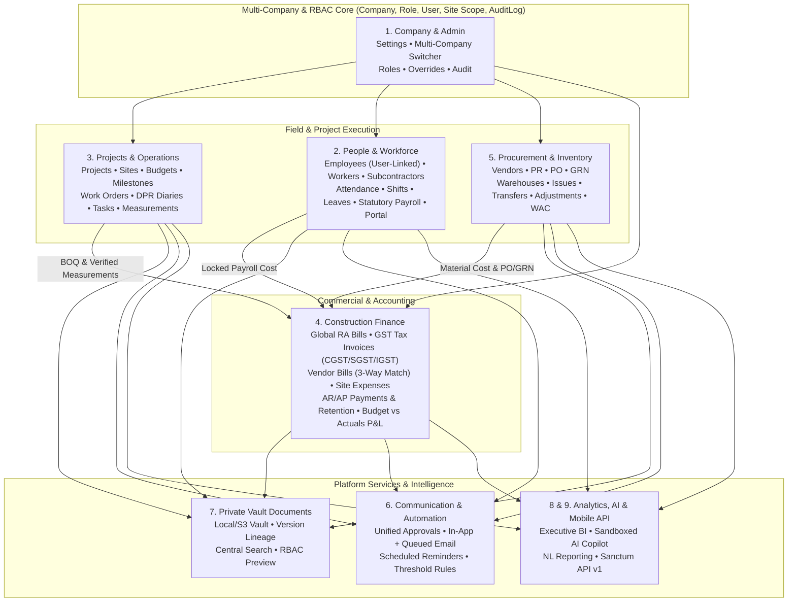

# NSD CRM 2.0 — Master Product Completion Blueprint

**Document Type:** Master Product Architecture & Completion Blueprint (Phase 5A)  
**Date:** 2026-11-15  
**Project Path:** `/Users/andrew/Developer/NSD-CRM-2.0`  
**Status:** Read-Only Audit Complete — Awaiting Stakeholder Approval Before Implementation

---

## 1. Product Vision & Strategic Objective

**Vision:** Evolve **NSD CRM 2.0** from a strong operational core into a **complete, multi-tenant, enterprise-grade Construction & Infrastructure ERP/CRM platform** tailored for civil engineering, earth-moving, industrial plant maintenance (e.g., JSW Steel contracts), and multi-site contracting companies—while preserving the simplicity that non-technical supervisors, storekeepers, and office clerks rely on every day.

### Core Product Pillars
1. **Zero-Friction Usability for Field & Office Teams:** Keep the Phase 1–3 UX standard across every new module—one clear primary action per screen, ordinary business language (supported in English, Hindi, and Marathi), progressive disclosure for advanced inputs, and clean mobile-ready layouts.
2. **End-to-End Site-to-Balance-Sheet Continuity:** Connect every site activity directly to project cost and revenue:
   - *Workforce -> Daily Muster/Kiosk -> Locked Payroll -> Project Labour Cost*
   - *Purchase Request -> PO -> GRN -> Warehouse Issue to Site -> Project Material Cost & Vendor AP*
   - *Client PO Upload -> Work Order BOQ -> Site Measurements -> RA Bill -> GST Tax Invoice -> Client Collection & Retention Release*
3. **Defense-in-Depth Multi-Tenant & Site Security:** Fail-closed tenant isolation (`BelongsToCompany`), explicit permission matrices (`PermissionCatalog` + per-user `allow`/`deny` overrides), strict site assignment boundaries, maker-checker non-self-approval, private vault storage, and immutable append-only audit trails.
4. **Incremental Evolution Without Rewriting:** Build directly atop the battle-tested Laravel 13, MySQL/TiDB, Blade + Alpine + Tailwind CSS 4 foundation (182 passing tests, 2,013 assertions).

---

## 2. Current Application Audit Summary (Ground Truth)

### 2.1 Codebase & Infrastructure Inventory
- **Backend:** Laravel 13.17 (PHP 8.4/8.5), 29 Migrations (`40` database tables), 37 Eloquent Models, 17 HTTP Controllers, 11 Domain Services, 8 Authorization Policies, 4 Custom Middleware, `Dompdf 3.1`, `PhpSpreadsheet 5.10`.
- **Frontend:** 54 Blade templates, Alpine.js, Tailwind CSS 4.2, Vite 8.3, Light/Dark theme persistence, trilingual UI (`en`, `hi`, `mr`).
- **Authentication & Access:** Staff session auth with rate limiting, TOTP + Email OTP 2FA (`TotpAuthenticatorService`), mandatory password rotation, 8 protected system roles, 5 custom role templates, 62 permission keys, Stateless Site Kiosk (`/kiosk/{token}`), and PIN-protected Employee Worker Portal (`/worker/*`).
- **Automated Quality Baseline:** 36 Feature/Unit test suites (`182` tests, `2,013` assertions, including `proc_open` parallel concurrency tests and transaction file-recovery tests).

### 2.2 What Is Already Strong (Do Not Rewrite)
- **Multi-Channel Attendance & Locking Engine:** Muster roll, QR badge scan, Kiosk terminal, GPS geofenced self-punch, anomaly flags, 4-stage lock, and non-self-approved `AttendanceCorrection` audit trail.
- **JSW Client PO Ingestion, BOQ & RA Billing Engine:** Deterministic PDF parsing (`JswWorkOrderPdfReaderService`), arithmetic verification, 2-tier Work Order & RA Bill approvals, strict 100% BOQ quantity cap with excess carry-forward, atomic FY invoice sequence (`invoice_sequences`), and Tax Invoice / Abstract PDF + live-formula XLSX exports.
- **Concurrency-Safe Sequences & Pessimistic Locking:** `worker_sequences`, `invoice_sequences`, `PurchaseOrder::lockForUpdate()`, and `InventoryStock::lockForUpdate()`.
- **Request-Memoized Tenancy & RBAC:** `TenantContext` + `User::$memoCompanyContext` delivering full dashboard loads in 48 queries.

### 2.3 Critical Product & Technical Gaps Uncovered in Phase 5A
1. **Onboarding Self-Sufficiency Blockers (Missing Master CRUDs):**
   - `Company`, `Warehouse`, `MaterialCategory`, `Material`, `Subcontractor`, `Client`, and `LeaveType` tables exist in the database, **but lack management CRUD screens**—forcing new tenants to rely on database seeders!
   - **Vendors** have no table at all (`PurchaseOrder` stores free-text `supplier_name`).
2. **Incomplete Inventory Ledger:**
   - Only Goods Receipt (`goods_receipt`) is implemented. **Warehouse Issue to Site**, **Inter-Site Stock Transfers**, **Site Material Returns**, **Stock Adjustments**, and **Weighted Average Valuation** are unimplemented.
3. **Half-Built Finance Cycle (Revenue Exists, Cost/AP/AR Missing):**
   - Outbound RA Billing works well (though lacking a global `/ra-bills` directory and IGST), **but Project Budgets, Standalone Tax Invoices, Credit/Debit Notes, Vendor/Subcontractor Bills (AP + 3-Way Match), Site Expenses/Petty Cash, Payment Tracking (AR/AP/Retention/TDS), Budget vs Actuals, and Financial Reports do not exist yet.**
4. **Synchronous-Only Communication & Ephemeral File Storage:**
   - Zero queued jobs (`app/Jobs`), zero Mailable/Notification classes, zero scheduled reminders (`routes/console.php`), and sparse in-app approval notifications.
   - Controllers hardcode `Storage::disk('local')`, which loses uploaded private files across stateless container redeployments until abstracted to a cloud-compatible `'vault'` disk (S3/R2).
5. **Specific Defects Flagged for Immediate Fix in Release 1:**
   - `DashboardController.php:160` queries `AuditLog` without `->where('company_id', $companyId)`.
   - `DashboardController.php:114` checks `PurchaseOrder` status `'ordered'` instead of `'issued'`.
   - `PayrollController.php:34-48` checks non-existent `payroll.manage` permission key instead of `PermissionCatalog`'s `payroll.create` / `payroll.edit` / `payroll.approve`.
   - `ProjectController.php:236` passes an empty `collect()` for `$recentLogs` on the Project Activity tab.
   - `ProcurementController` has `approveRequest` but no `rejectRequest` endpoint.

---

## 3. Target Product Domain Architecture

---

## 4. Target Information Architecture & Simplified Navigation

To add major capabilities (Finance, Vendors, Warehouses, Approvals, Document Vault, Analytics, AI) **without re-introducing sidebar clutter**, the simplified role-aware sidebar will organize screens into **7 clean top-level workspaces** (with sub-tabs inside each workspace):

1. **Dashboard** (`/dashboard`) — Role-tailored overview + badge link to **Pending Approvals** (`/approvals`).
2. **Projects & Sites** (`/projects`, `/sites`, `/clients`) — Tabs for Overview, Sites, Budgets, Milestones, Daily Diaries (DPR), Documents, Activity.
3. **Work Orders & Tasks** (`/work-orders`, `/tasks`) — Client & Subcontractor Work Orders, PO Uploads, Measurements, Field Tasks & Notes.
4. **People & Attendance** (`/workforce`, `/attendance/register`, `/payroll`) — Workers, Subcontractors, Monthly Register, Daily Muster/Kiosk, Shifts & Leaves, Payroll & Payslips.
5. **Procurement & Inventory** (`/procurement/requests`, `/inventory/stocks`) — Sub-navigation for Purchase Requests, Purchase Orders, Vendors, Warehouse Stock, Issues/Transfers/Adjustments, Materials & Warehouses Catalog.
6. **Finance & Billing** (`/finance`) — Sub-navigation for RA Bills, Tax Invoices, Vendor Bills, Site Expenses, Payments (AR/AP & Retention), Budget vs Actuals.
7. **Reports, Documents & Admin** (`/reports`, `/documents`, `/analytics`, `/admin/users`, `/admin/company`) — Visible strictly per role permissions; includes Audit History and optional AI Assistant drawer.

---

## 5. Cross-Cutting Engineering & Security Standards

Every feature built across Releases 1–5 must adhere to these non-negotiable rules:
1. **Strict Tenant & Site Scoping:** Every new table with tenant data must include `company_id` (`constrained('companies')->cascadeOnDelete()`), use `BelongsToCompany`, and enforce `User::isAssignedToSite()` in both Policies and Controllers/Exports.
2. **Concurrency & Transaction Integrity:** All multi-row writes (Stock Transfers, Vendor Bill 3-Way Match, Payment Allocations, Invoice Numbering, Payroll Locking) must execute inside `DB::transaction()` with deterministic `lockForUpdate()` ordering and orphaned-file rollback cleanup.
3. **Segregation of Duties (Maker-Checker):** Preserve explicit permission requirements (`attendance.mark`, `attendance.edit`, `attendance.approve`, `attendance.export` never auto-granted via `*`) and non-self-approval across Attendance Corrections, Leaves, Purchase Requests, Adjustments, Expenses, Vendor Bills, Work Orders, and RA Bills.
4. **Cloud-Safe Private Vault:** Store zero business documents under `public/`; route all uploads/downloads through `VaultStorage` (`vault` disk: `local` in dev/test, private `s3`/R2 in production) with `Gate::authorize()`, `nosniff` headers, and `AuditLog` tracking.
5. **Sandboxed AI Governance:** Never pass raw database credentials, cross-tenant data, PII fields, or unrestricted SQL execution to any AI model; execute all AI reads via policy-checked PHP tools.

---

## 6. Companion Deliverables Index

This blueprint is accompanied by three detailed technical specifications in `/docs`:
1. **[FEATURE_GAP_ANALYSIS.md](file:///Users/andrew/Developer/NSD-CRM-2.0/docs/FEATURE_GAP_ANALYSIS.md):** Granular evaluation of all 48 features across all 9 product domains (classification, existing code, missing functionality, dependencies, security, complexity, and priority).
2. **[ARCHITECTURE_REVIEW.md](file:///Users/andrew/Developer/NSD-CRM-2.0/docs/ARCHITECTURE_REVIEW.md):** Deep-dive architectural evaluation across Multi-Company isolation, 10,000+ Worker scaling, Transaction volume indexing, Cloud Vault file storage, Tenant-Aware Queue/Scheduler workers, REST `/api/v1`, and Mobile offline sync.
3. **[DEVELOPMENT_ROADMAP.md](file:///Users/andrew/Developer/NSD-CRM-2.0/docs/DEVELOPMENT_ROADMAP.md):** Phased 5-Release execution plan (`Release 1` through `Release 5`), measurable release acceptance criteria, and the 30-item prioritized implementation backlog (`BL-01` to `BL-30`).

---

## 7. Open Decisions for Stakeholder Review Before Release 1

Before we exit read-only planning and begin **Release 1 (Core Product Completion)**, please confirm or adjust the following product preferences:
1. **Release 1 Scope Confirmation:** Do you approve the Release 1 scope (`BL-01` through `BL-15`: fixing the 4 audit/permission/PO bugs, Company Profile & Switcher, Warehouses/Materials/Vendors/Subcontractors/Clients CRUD, Stock Issues/Transfers/Adjustments, Unified Approvals Inbox + In-App Notifications, Global RA Bills + IGST, and `VaultStorage` disk abstraction)?
2. **Office Staff Default Procurement Permission:** Should `office_staff` have `procurement.request` (ability to submit Purchase Requests) enabled by default in `PermissionCatalog`, or keep it opt-in per employee?
3. **Statutory Payroll Rules (Release 2 Prep):** For Indian statutory deductions (PF / ESIC / Professional Tax), should deductions be toggleable per individual worker/employee (since daily casual labour vs salaried employees often have different applicability)?
4. **Target Cloud Object Storage (Release 1 Abstraction / Release 5 Cutover):** Do you prefer **Cloudflare R2** (S3-compatible, zero egress fees, generous free tier) or **AWS S3** for production private document storage when moving beyond local development?

